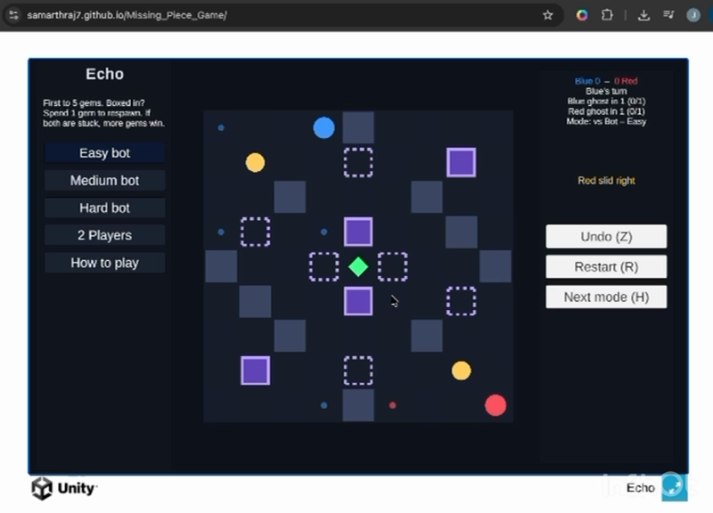

# Echo

**A competitive sliding-puzzle game where every five moves come back to haunt the board.**

[Play Echo in your browser](https://samarthraj7.github.io/Missing_Piece_Game/) · [Watch the Alpha demo](Documentation/Echo-Demo.mp4) · [Read the Game Design Document](Documentation/Echo-GDD.pdf)



## About the game

Echo is a turn-based, two-player sliding puzzle built in Unity. Blue and Red race to collect five gems. A move sends the active player sliding in one direction until a wall, player, ghost, or raised purple wall stops them.

The twist is memory: after a player completes five moves, a ghost appears near the starting point of that sequence. On each later turn by its owner, the ghost repeats the next recorded direction. Ghosts can collect gems, trigger switches, and block either player, so a useful route now can reshape the board several turns later.

## Play

The current Alpha supports:

- Easy, Medium, and Hard bot opponents
- Local hot-seat two-player mode
- Keyboard, on-screen button, and swipe controls
- Undo, restart, and boxed-in recovery
- One active ghost per player in the current build

### Rules

1. Blue moves first; players alternate turns.
2. Choose a direction and slide until an obstacle stops you.
3. Passing through the green diamond collects it and spawns another gem.
4. Passing over a yellow switch flips every purple wall: filled walls are raised, while dotted walls are lowered.
5. Every five valid moves create a ghost that loops those five directions, advancing once on each of its owner's turns.
6. The first player to collect five gems wins.

If a player is boxed in, they may spend one gem to respawn or skip the turn. If both players are trapped, the player with more gems wins; equal scores produce a draw.

### Controls

| Action | Keyboard | Other input |
| --- | --- | --- |
| Slide | Arrow keys or `WASD` | On-screen arrows or swipe |
| Undo | `Z` | — |
| Restart | `R` | New Game button |
| Cycle game mode | `H` | Mode buttons |
| Select Easy / Medium / Hard / 2 Players | `1` / `2` / `3` / `4` | Mode buttons |
| Spend a gem to respawn | `G` or `Enter` when prompted | Prompt button |
| Skip a boxed-in turn | `N` | Prompt button when no gem is available |

## Project links

- **Playable WebGL build:** https://samarthraj7.github.io/Missing_Piece_Game/
- **Source repository:** https://github.com/samarthraj7/Missing_Piece_Game
- **Alpha demonstration:** [Echo-Demo.mp4](Documentation/Echo-Demo.mp4)
- **Game Design Document:** [Echo-GDD.pdf](Documentation/Echo-GDD.pdf)

## Team

| Team member | Primary contribution |
| --- | --- |
| Samarth Rajendra | Team Captain; gameplay and AI programming |
| Jeevika Kiran | Product Manager; scoring and analytics programming |
| Rhesha Susil Vinod | Stenographer; UI and controls programming |
| Sanath Nagendra Bhargav | Level design; switches and arena programming |
| Prathiksha Ravibabu Nijamkari | Ghost systems and visual feedback programming |

## Run locally

1. Install **Unity 6.0**. The project was last saved with Unity `6000.6.0f1`.
2. Clone the repository:

   ```bash
   git clone https://github.com/samarthraj7/Missing_Piece_Game.git
   ```

3. Open the cloned folder from Unity Hub.
4. Open `Assets/Scenes/Main.unity` and enter Play mode.

## Build for the web

The checked-in `docs/` directory is the GitHub Pages build.

1. In Unity, choose **Echo → Build WebGL to docs**, or select the Web build profile and use `docs` as the output directory.
2. Test the generated build locally through an HTTP server.
3. Commit and push the updated `docs/` directory to `main`.
4. Configure GitHub Pages to deploy from the `main` branch and `/docs` folder.

## Repository structure

```text
Assets/
  Levels/          ScriptableObject level layouts
  Scenes/          Main game and UI sandbox scenes
  Scripts/         Rules, state, AI, rendering, and input
  Editor/          Level-generation and WebGL build utilities
Documentation/     Alpha demo, screenshot, and GDD
Packages/          Unity package manifest and lock file
ProjectSettings/   Unity project configuration
docs/              Deployable WebGL build for GitHub Pages
```

## Alpha status

This repository contains an Alpha prototype. The core race, sliding movement, gems, switches, dynamic walls, bot difficulties, local multiplayer, and repeating ghosts are playable. The current implementation intentionally limits each player to one active ghost; balancing, accessibility, additional levels, audio, and further polish remain in development.

## Credits

Created for USC Game Development, Fall 2026. The project uses Unity and TextMesh Pro; included Liberation Sans assets are distributed under their accompanying license.
